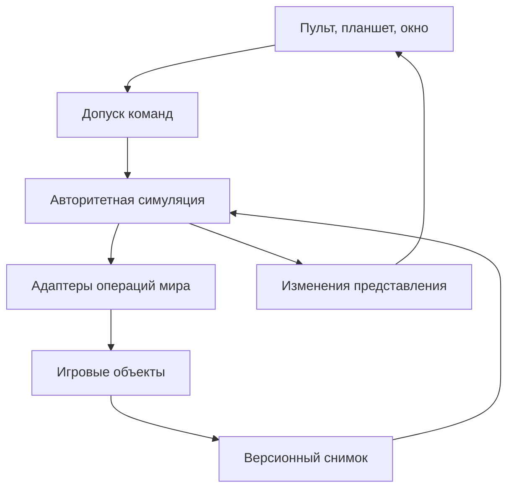

# Архитектура первого решения

Статус: проектное предложение от 2026-11-09. Код мода не реализован. Ограничения подключения приведены в [матрице совместимости](../system/compatibility.md); обработка сохранений — в [жизненном цикле данных](../system/persistence.md).

## Граница системы

Мод работает внутри процесса Satisfactory. В первой проверяемой реализации решения принимаются алгоритмами C++; Blueprint отвечает за представление, анимацию и интеграцию игровых ассетов. Базовой системе не нужны LLM, трансформеры, обучение, GPU inference, интернет, HTTP-сервер, аккаунты внешнего сервиса и отдельная база данных.

На хосте или dedicated server живёт единственная авторитетная симуляция специалистов. Она получает факты мира, планирует действия и через игровые адаптеры изменяет мир. На клиенте с модом существуют отображение, локальные настройки и отправка намерений. Локальный хост проходит через те же правила допуска команд, что сетевой клиент.

Схема задаёт ответственность, а не список обязательных UObject-классов. Небольшие связанные обязанности могут оставаться обычными функциями внутри своего модуля.

## Модули и владельцы состояния

| Область | Собственная обязанность | Владеет состоянием | Не выполняет |
| --- | --- | --- | --- |
| Lifecycle | Создать/восстановить сессию мода и остановить её | Версия схемы, ID мира, bootstrap, остановка | Поиск ресурсов и планирование ролей |
| World adapters | Читать игровые факты и выполнять конкретные операции через поддержанные возможности | Краткоживущие ссылки на игровые объекты, каталог возможностей | Выбор задач, баланс найма, оптимизацию фабрики |
| Registry | Связать устойчивый ID с загруженным объектом | ID, поколение, состояние loaded/unloaded/destroyed | Автоматическую замену удалённого склада ближайшим |
| Staffing | Каталог кандидатов, найм, посадочная очередь, roster | Предложения, оплата, HireId, BotId, этап прибытия | Передвижение бота и самостоятельный расход ресурсов на найм |
| Task scheduler | Назначить допустимую задачу, lease и результат исполнения | Очередь, зависимости, попытки, причины ожидания | Внутренности добычи, строительства и лечения |
| Role policies | Выбрать одну полезную цель согласно роли | Параметры роли, фильтры, приоритеты | Непосредственное изменение мира |
| Navigation | Построить и исполнить разрешённый маршрут | Граф доступности, запросы путей, маршрут | Генерацию ресурсов, боевую логику |
| Logistics | Резервирование, складские правила, доставка | Связи бот–склад, квоты, резервы | Изменение инвентаря через обход authority |
| Analysis | Снимки коммуникаций и предложения улучшения | Версии графов, очередь анализа, ограничения | Самостоятельный снос или принятие плана |
| Plan execution | Превратить принятую редакцию плана в DAG работ | PlanId, revision, операции, фактически выполненные части | Переписывание решения пользователя |
| Presentation | Представить состояние и собрать команду пользователя | Фильтры, открытые вкладки, локальная геометрия окна | Истину об инвентаре и правах |
| Persistence | Сериализовать согласованный снимок и восстановить ссылки | Версия сохранения, журнал операций, миграции | Продолжение недопроверенной операции при загрузке |
| Diagnostics | Ограниченные метрики, трассировка и объяснение решения | Кольцевой журнал и агрегаты | Постоянный полный дамп мира |

DTO содержат данные. Подготовка преобразует сырой запрос в достаточный вход. Политика принимает предметное решение. Оркестратор вызывает самостоятельные шаги снаружи. Исполнитель выполняет один микрошаг и выдаёт типизированный исход; он не запускает произвольный следующий сценарий.

## Встраивание в SML и Unreal

Документация SML предоставляет `AModSubsystem` с политиками существования и репликации. Для сохранённой симуляции исследуется серверный subsystem; клиентское представление выделяется отдельно. `SpawnOnServer` не реплицируется клиентам, `SpawnOnServer_Replicate` реплицируется. Поэтому публичный subsystem с модовым классом нельзя автоматически считать безопасным для клиента без мода. Источник: [Mod Subsystems](https://docs.ficsit.app/satisfactory-modding/latest/Development/ModLoader/Subsystems.html).

Для полной модифицированной сессии клиентские команды идут через принадлежащий соединению RCO, а состояние — через подходящий реплицируемый объект. В RCO не применяется multicast. Dedicated server не должен обращаться к локальному игроку с индексом 0 для определения authority. Это соответствует [рекомендациям SML Multiplayer](https://docs.ficsit.app/satisfactory-modding/latest/Development/Satisfactory/Multiplayer.html). Точные классы и сигнатуры выбираются по установленному SDK; названия доменных контрактов ниже не являются готовыми игровыми API.

Все обращения к Actor/UObject и все изменения мира выполняются на game thread. Фоновые расчёты получают неизменяемые структуры без UObject-ссылок. Результат содержит версию снимка и ограничения; применение вновь проверяется на границе операции. Поздний результат после смены мира или отмены отбрасывается по session generation. Уничтожение объекта и истечение lease — штатные события, а не бесконечные повторы алгоритма.

## Отдельное окно базовых настроек

Рекомендуемый вариант исследования — немодальное нативное Slate `SWindow` в процессе игры: это отдельное окно ОС без подключения к API и без второго runtime. Окно не содержит собственную симуляцию и использует ту же подготовку команд, что планшет. Unreal документирует [`SWindow`](https://dev.epicgames.com/documentation/unreal-engine/API/Runtime/SlateCore/SWindow) и [`FSlateApplication`](https://dev.epicgames.com/documentation/unreal-engine/API/Runtime/Slate/FSlateApplication).

Доступность в выбранной packaged Satisfactory-сборке не проверена. До фиксации решения нужен spike: создание окна, DPI/несколько мониторов, fullscreen/borderless, фокус, клавиши, alt-tab, закрытие, выход в меню, reload мира и полное завершение игры. На dedicated server окно не создаётся. Если проверка не проходит, отдельно предъявить владельцу вариант обычного игрового окна или внешнего приложения; отдельный процесс с IPC не добавляется автоматически.

## Жизненный цикл первого запуска

1. После готовности мира загрузить сохранённое состояние мода и определить поколение сессии.
2. Если bootstrap ещё никогда не выполнялся в этом сохранении, найти свободное безопасное место рядом с разрешённой исходной зоной игрока. Проверить terrain, свободный объём, доступность пешего подхода и отсутствие чужих строений; если места нет, выдать пользователю задачу размещения.
3. Создать один пульт с площадкой и сохранить `BootstrapCompleted` и `StationId`. Идемпотентность определяется состоянием мира, а не каждым `BeginPlay` игрока.
4. При последующих входах и загрузках восстановить существующую станцию. Если она была разобрана, сохранить факт удаления; не возвращать её самовольно на прежнее место и не создавать станцию для каждого подключившегося игрока.

Бесплатная первая станция и право восстановления за материалы — предложения баланса, которые требуется подтвердить до реализации. Её точные размеры и рецепт не заданы запросом.

## Найм и прибытие

Каждое предложение содержит ID, редакцию, роль, имя, внешний вид, цену в предметах и срок по времени симуляции. Обновление каталога не изменяет уже оплаченный контракт. Авторитетная операция найма проверяет конкретную редакцию предложения, права, лимит специалистов, станцию и ресурсы; `CommandId` защищает от повторного клика/доставки запроса.

Плата переводится в учтённый escrow один раз. Контракт найма отдельно от косметической капсулы. Посадки сериализуются слотами площадки; занятое место даёт очередь с видимой причиной. Перед посадкой проверяются свободный объём и выход. Анимация не является доказательством появления бота: roster и `BotId` определяются авторитетной записью. При загрузке движение капсулы можно восстановить упрощённо, сохранив результат оплаты и число ботов.

При невозможности появления до создания бота предлагается отмена с полным возвратом escrow. При заполненном исходном инвентаре возврат хранится как выдаваемый долг или в явно обозначенном доступном контейнере, а не теряется и не дублируется. При уже созданном боте повторная посадка не выполняется. При гибели после ввода в строй новый контракт найма не создаётся автоматически.

## Масштабирование и отказоустойчивость

Вместо полного сканирования мира каждый кадр используются события изменения объектов, пространственные индексы, очередь обновления грязных областей и ограниченный начальный обход. Планировщик работает порциями с ограничением времени, а не отдельным Tick для каждого решения каждого бота. Каталог возможностей и шаблоны ролей описывают поведение данными; универсальный метод со всеми ролями и глубокими ветками не вводится.

Алгоритмы и их независимая оценка описываются в [ресурсном плане](../system/performance.md). Снимки, кэши, журналы и очередь событий имеют лимиты; при превышении выполняется объединение событий и контролируемая переиндексация, а не молчаливое отбрасывание изменения мира.

Цель MVP — проверяемый сквозной сценарий одного помощника. Масштабирование до множества ролей начинается после измерений на этой версии игры. Производительность и отсутствие утечек пока не измерены.
