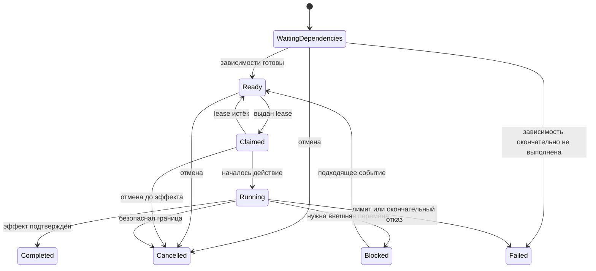

# Задачи ботов, планы и перепланирование

Статус: проектирование. Это игровые задачи внутри мода; [TASKS.md](../../TASKS.md) управляет разработкой самого проекта. Профили исполнителей — в [specialists.md](specialists.md), подготовка фабричных планов — в [logistics_and_analysis.md](logistics_and_analysis.md).

## Разделение сущностей

| Сущность | Что хранит | Кто отвечает |
| --- | --- | --- |
| Потребность | Чего не хватает, кому, для чего, сколько и насколько срочно | Реестр потребностей |
| Задача | Один проверяемый результат, зависимости, область доступа, исполнитель, статус и причина | Планировщик |
| Действие | Одна ограниченная по времени операция с миром и фактический результат | Исполнитель действия |
| План | Цель преобразования фабрики, ограничения, альтернативы и граф шагов | Аналитик/владелец |
| Ревизия плана | Неизменяемый вариант на определённом снимке мира | Хранилище планов |
| Одобрение | Какие действия какой ревизии и в каких пределах разрешены | Authority по выбору игрока |
| Журнал эффекта | Что реально выполнено, сколько ресурсов перемещено, какие ID появились | Граница изменения мира |

Оркестратор вызывает подготовку, выбор, исполнение и запись результатов. Он не содержит формулы потоков, пересчёт складов или ветви каждой роли. Планировщик не строит объекты, UI не выдаёт себе предметы, аналитик не подменяет одобрение.

## Состояния задачи

`Ready` означает, что зависимости завершены и необходимые условия подготовки обеспечены; карточка с ещё неготовыми зависимостями находится в `WaitingDependencies`, а не опрашивает их каждый кадр. Событие о выполненной зависимости обновляет только соседей графа. `Completed`, `Cancelled`, `Failed` сохраняются в ограниченной истории и не считаются готовой работой. Повторное открытие создаёт новую попытку с причиной, сохраняя прежний эффект.

Карточка содержит стабильный ID, корневую потребность, роль/необходимые возможности, зависимости, текущую попытку, приоритет, фактический прогресс, время последнего продвижения, причину ожидания, следующий триггер и ссылку на действие/ревизию плана. Сырые входы не проходят в исполнителя без подготовки.

В read model планшета карточка бота связывает `BotId`, `TaskId` и версию задачи с маршрутом: `RouteId`, ревизия маршрута, источник, назначение, текущий участок, статус и причина остановки. Источник и назначение содержат устойчивый ID объекта/точки и позицию на конкретном снимке карты. Для ещё не рассчитанного или ненужного маршрута явно показывается `Pending`/`NotRequired`, а не выдуманные точки и нулевой путь. Пересчёт меняет ревизию маршрута; UI отбрасывает дельту старой ревизии и не рисует старый путь как текущий. Предлагаемые состояния готового маршрута: `Active`, `Blocked`, `Completed`, `Cancelled`.

## Выбор следующей работы

Подготовленные очереди разделяются на фиксированное небольшое число классов приоритета, затем по области и необходимой возможности. Внутри класса хранится FIFO готовых ID; дополнительно пространственный индекс даёт локальных кандидатов. При выдаче конкретному боту объединяются ограниченный префикс старейших и локальные подходящие задачи. Их актуальные возраст, доступность и подготовленная оценка пути пересчитываются одним проходом O(C), где C — размер этого набора. Получение/пересчёт самой оценки пути имеет отдельную стоимость и не спрятано в O(C). Нельзя сканировать все пары «каждый бот × каждая задача» каждый кадр.

Защита от голодания задаётся явными квотами между обычными классами и событиями повышения долго ожидающей готовой задачи; критическая безопасность сохраняет преимущество. Старейшие заявки входят в набор независимо от близости, поэтому пространственный фильтр не исключает далёкую работу навсегда. В FIFO/индексе не хранится якобы неизменяемый ключ из времени и стоимости пути конкретного бота. Обычная heap с таким динамическим ключом не сохраняет корректный минимум и здесь не выбрана. Heap допустима отдельно для стабильных сроков событий/истечения lease, с контролируемым обновлением и размером.

Lease получает один исполнитель; продление идёт при подтверждённом прогрессе, а не просто от существования бота. Выбор гарантирует заявленную fairness при наличии доступного исполнителя и устойчивой допустимой нагрузки; бесконечный поток непосредственных угроз не даёт обещания конечного срока обычной работы.

Общая логика принятия решения имеет фиксированный порядок именованных политик: `NeedsImmediateSafety`, `MustFinishTransferBoundary`, `NeedsUnload`, `HasReadyAssignedTask`, `HasUsefulFallback`, `ShouldWaitForWorldEvent`. Это имена проектных политик, не существующие методы SDK. Каждая политика получает подготовленное состояние и возвращает только своё решение. Поддержанные HTN-шаблоны «подготовить оружие», «доставить ресурс» или «построить участок» раскрываются в конечный ацикличный граф действий, а не в рекурсивный универсальный решатель.

Пример графа доставки: резерв источника и назначения → получение доступной партии → перемещение → передача фактического количества → освобождение остаточных резервов. Если приходится разделить партию, появляется дочерний остаток той же потребности, а не независимая заявка, позволяющая двойную оплату/добычу.

## Протокол против зацикливания

| Ситуация | Переход | Условие повторного запуска |
| --- | --- | --- |
| Нет пути | Освободить попытку, записать отрицательный маршрут, взять другую работу | Изменение топологии, освобождение прохода или ограниченный таймаут |
| Нет предмета/инструмента | Одна дедуплицированная потребность; доступный fallback | Поступление ресурса, открытие рецепта, изменение источника |
| Хранилище заполнено | Альтернативный разрешённый склад/буфер, затем ожидание | Освободилось место или назначен новый склад |
| Цель уже собрана/построена другим | Сверка факта, завершение/пересчёт остатка | Повтор отсутствует, если цель уже достигнута |
| Мир изменился во время расчёта | Отменить устаревшее действие до эффекта | Новая ревизия снимка и подготовка |
| Здоровье/боезапас падают | Прервать на безопасной границе, отступить, запросить снабжение | Достигнуты условия безопасности |
| Нет прогресса по позиции/эффекту | Ограниченная попытка локального восстановления, затем отказ от цели | Разрешённое изменение маршрута/мира |
| Цепочка снабжения вернулась к тому же требованию | Отклонить ребро зависимости, показать цикл | Изменение потребности или внешнего источника |

Настраиваемые лимиты: время действия без прогресса, количество повторов, глубина HTN, число раскрытых узлов, время поиска пути, срок отрицательного кэша и пауза до очередного осмотра. Значения выбираются по игровым измерениям. Ни одна попытка не имеет бесконечного deadline. Снижение частоты фонового расчёта не освобождает действие от срока проверки его безопасности.

## Резервы и побочные эффекты

Резерв предметов, вместимости, площадки и исполнителя имеет владельца, назначение, количество, срок и ревизию. Перед получением/передачей authority сверяет актуальное состояние и фиксирует только фактический эффект. Предметы, уже попавшие в рюкзак, считаются в рюкзаке, а не одновременно в источнике. Остаток резерва может освобождаться; полученная партия не «возвращается» в исходный склад без физической передачи.

Каждая команда имеет idempotency key; повторный ответ сети или восстановление из сохранения читает подтверждённый результат, а не повторяет эффект. Для нескольких последовательных физических действий используется журнал промежуточного состояния. Обещание общей атомарности на всём переносе, стройке или перестройке не даётся: игроки и мир могут изменяться между шагами. «Откат» — отдельная разрешённая компенсирующая работа с реальной стоимостью, а не удаление истории.

Захват нескольких резервов выполняется в стабильном порядке ID или через единый координатор резервирования. Частичный провал освобождает только ещё неиспользованные резервы. Взаимные ожидания складов/исполнителей имеют срок и видимую причину. Смерть, увольнение, закрытие мира и исчезновение объекта инициируют согласование журналов перед повторной выдачей работы.

## Жизненный цикл плана

План проходит `Requested → Analysing → Proposed → Approved → Executing → Completed`. Отдельные выходы: `NeedsRevision`, `Blocked`, `Rejected`, `Cancelled`, `Stale`. Состояние `Proposed` допускает частичное одобрение, но только по проверяемым шагам с замкнутыми необходимыми зависимостями. Аналитик берёт по одной задаче из очереди; тяжёлый расчёт может идти порциями по кадрам, не занимая основной поток без предела.

Ревизия содержит ID плана, номер ревизии, версию снимка мира, цель, выбранные ограничения, доказуемые оценки ресурсов/времени, неизвестные параметры и граф действий. Старую ревизию не переписывают. Карта показывает одновременно фактически построенное, актуальный вариант и устаревший фрагмент с объяснением; новые идеи не перекрашивают уже завершённое в «не существовавшее».

Уведомление «План готов» появляется по выпуску предложения. Игрок принимает весь допустимый план, выделенные независимые части или отправляет на доработку, закрепив запреты и ключевые точки. Частичное принятие замыкается по зависимостям: интерфейс показывает необходимые дополнительные шаги и общую стоимость, затем одобрение записывается на точную ревизию. Неодобренные части остаются предложением.

Если игрок правит узел/ребро, утверждённый вариант не меняется задним числом: меняется набор ограничений, создаётся заявка новой ревизии, затронутые не начатые шаги приостанавливаются. Незатронутые уже одобренные действия могут продолжаться, только если они не используют ресурсы/объекты, конфликтующие с новой областью. Принятие устаревшего предложения сначала требует актуализации, а не молчаливого выполнения.

## Частичное выполнение и смерть исполнителя

После потери бота, сноса объекта игроком, закрытия мира или изменения связи аналитик получает задачу на актуальный остаток. Сверка журнала с миром классифицирует каждый шаг: эффект существует; выполнен частично; цель исчезла; подтверждение неизвестно; ещё не начинался. Повтор не создаёт второй объект, если первая постройка уже существует с записанным ID.

В новую ревизию переносятся факты завершённых эффектов и остаток доступного инвентаря, а не старое обещание о начальных ресурсах. Завершённые объекты становятся ограничениями исходного состояния. Если дальнейшее улучшение требует переделать уже построенное, демонтаж появляется новым видимым шагом с новой стоимостью и одобрением. Потеря специалиста меняет доступность исполнителей, но не означает, что другой специалист автоматически умеет его роль.

Пользовательские закрепления имеют приоритет над оптимизацией: обязательные точки, сохранённые рёбра, запрещённые области, запрещённый демонтаж, лимит ресурсов и требуемая пропускная способность. При несовместимости аналитик возвращает `NoFeasiblePlan` с минимально понятным набором конфликтующих условий. Он не снимает запрет без решения игрока и не «решает» конфликт бесконечным пересчётом.

## Номера планов

Дословное требование: «Планы имеют номера из 3х букв и 10тыс цифр. Как перепролняюстя план идет заного». Оно допускает два разных смысла: три буквы и буквально 10 000 десятичных разрядов либо три буквы и циклический числовой диапазон около 10 тысяч. Выбор не сделан. Эта неоднозначность блокирует реализацию формата отображения, но не планировщик.

Для внутренних ссылок предлагается независимый UUID и монотонный номер ревизии. Внешний циклический номер — отдельное отображение с поколением цикла, поэтому при переполнении история, одобрения, задачи и сохранения не начинают ссылаться на другой план. UUID не сбрасывается вместе с внешней нумерацией; номер нельзя использовать как единственный ключ. Если выбраны буквальные 10 000 цифр, заранее определить сокращённое отображение и операции с текстовым идентификатором, не превращая его в огромное число в каждом Tick.

## Проверяемые инварианты

Один живой бот не выполняет два атомарных действия одновременно; один lease принадлежит одному исполнителю. Граф зависимостей действий плана и цепочка делегирования не имеют циклов; фабричные коммуникации, граф навигации и последовательность патруля могут содержать циклы и не превращаются в DAG. Одобрение относится к неизменяемой ревизии. Игровой эффект учитывается один раз. Невозможное действие имеет конечный выход и понятный триггер возврата. Завершённое действие не отменяется только от смены исполнителя. Ни обещание полезной работы, ни поиск оптимума не оправдывают бесплатную генерацию ресурсов.

Для engine-интеграции сначала сравнить с доступными средствами Unreal Behavior Tree/Navigation. [Официальный обзор Behavior Tree](https://dev.epicgames.com/documentation/unreal-engine/behavior-tree-in-unreal-engine---overview) объясняет событийный подход; конкретная совместимость выбранного SDK и поведения Satisfactory ещё требует проверки. Предлагаемая предметная модель очередей и планов не зависит от наличия конкретного инструмента редактора.
