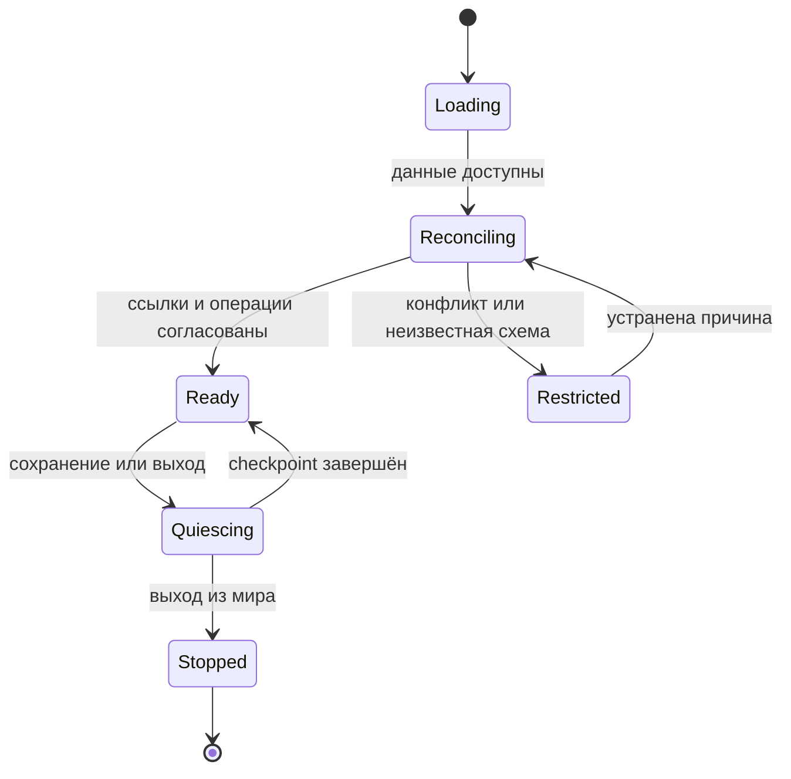

# Сохранения, разрушение и восстановление

Статус: проектные контракты для проверки на фактической версии Satisfactory. Используется поддерживаемая игровая SaveGame-система, а не внешний журнал, который может разойтись с сохранением мира.

## Состав сохранения

Документация Satisfactory описывает `IFGSaveInterface`, `ShouldSave`, порядок `GatherDependencies`, `SaveGame`-поля и lifecycle сохранения/загрузки. Сериализуется только явно включённое состояние; произвольный runtime-кэш не сохраняется автоматически. Не создавать циклы зависимостей сохранения. Источник: [Save Game](https://docs.ficsit.app/satisfactory-modding/latest/Development/Satisfactory/Savegame.html).

| Состояние | Сохранять | Восстановление |
| --- | --- | --- |
| SaveId, schema version, bootstrap | Да | Проверить поддержанную версию; первая платформа не появляется повторно |
| Роли и roster | BotId, generation, имя, роль, параметры, жив/мёртв, ссылка на физическое представление | Сверить с фактическими игровыми сущностями, не создавать второй экземпляр |
| Инвентарь бота | Один авторитетный физический инвентарь | Не копировать отдельную таблицу предметов поверх уже восстановленного инвентаря |
| Складские привязки | StorageId/Generation, фильтры, приоритеты и квоты | Разрешить ссылки; отсутствующее состояние явно показать |
| Каталог найма | OfferId/Revision, имя/роль/вид, остаток до refresh | Не reroll после загрузки и не возвращать просроченное предложение |
| Найм и посадки | HireId, оплаченный escrow, BotId, этап, refund state | Завершить или вернуть только оставшуюся обязанность |
| Задачи и планы | ID, редакции, зависимости, accepted operations, остатки, причины и незавершённые операции | Сверить с миром и открыть только пригодные остатки |
| Узлы маршрутов | Посещения, индивидуальное время затухания и существенные отметки | Продолжить от времени симуляции без глобального обнуления |
| Leases | Сохранить данные, нужные для reconciliation; не доверять старому runtime lock | Пересобрать резервы из физического владения и остатка задач |
| Статические кэши графа | Не обязательно | Восстановить ограниченным индексированием; UI показывает incomplete coverage |
| Событийный журнал | Только ограниченные записи незавершённых операций и нужная история | Компактировать завершённое после согласованного save checkpoint |
| Клиентские настройки | Отдельно от правил мира, по установке/пользователю | Не подменяют authority; схема и миграция настроек независимы |

Soft object/class references нельзя объявлять автоматически сохраняемыми: документация отмечает ограничения ряда типов. Формат сериализации ссылок выбирается и проверяется на SDK. Устойчивый ID, ожидаемый класс/capability и поколение проверяются после разрешения ссылки. Runtime raw pointer, адрес памяти, ActorLabel и номер игрока в тестовой IP-сессии не служат постоянной идентичностью.

## Согласованный checkpoint

В мире одновременно существуют обычные игровые изменения и состояние мода. Нельзя обещать межобъектную транзакцию, которой нет в SDK. Проектный механизм: менять мир небольшими сериализованными микрошагами на game thread и фиксировать каждую границу вместе с собственным учётом. Перед сериализацией приостановить выдачу новых микрошагов и сформировать согласованный снимок уже завершённых операций; точный save hook и допустимая длительность проверяются отдельно. Нельзя блокировать game thread ожиданием фонового worker, который сам ждёт game thread.

Операции строительства/переноса/найма получают устойчивый `OperationId`. Подтверждённый результат сохраняется в том же игровом checkpoint, что соответствующее состояние мира. На загрузке журнал сверяется с реально восстановленными объектами. Запись «планировал построить» не доказывает построение; существующий объект с OperationId не строится второй раз. Если состояние не удаётся однозначно восстановить, операция блокируется для reconciliation, а не повторяет разрушительный шаг наугад.

Гарантия относится к повтору команд и загрузке последнего согласованного сохранения. Внезапное завершение игры до очередного save откатывает мир к последнему сохранению по обычным правилам игры; постоянное сохранение каждого движения и crash-proof хранилище не обещаются.

## Загрузка и смена мира

В `Loading` и `Reconciling` запрещены найм, расход, снос и новое строительство. `Restricted` сохраняет доступ к диагностике и безопасному чтению; не переписывает неизвестную будущую схему. Ошибка миграции не уничтожает исходное сохранение. Смена мира отменяет jobs, подписки и маршруты, увеличивает `SessionGeneration`, освобождает UI handles и исключает применение позднего результата к новому миру.

## Реальные инвентари и частичное выполнение

Перенос имеет остаток и физического владельца груза. Пример: требовалось 100 деталей; бот фактически взял 60, внёс 40, несёт 20. Сохранённая задача отражает 40 доставленных и 20 у бота; после загрузки нельзя снова изъять все 100. Изменение склада игроком между reserve и pickup приводит к частичному/невозможному изъятию, а не отрицательному балансу.

Если destination заполнен, груз остаётся у бота. Подбирается другое разрешённое хранилище либо создаётся запрос освобождения места. Временный контейнер строится только за реально доступные материалы, в разрешённом месте и с учётом лимита; при невозможности бот не создаёт бесконечную цепочку ящиков. В крайнем случае он сохраняет груз и видимую причину блокировки, уступая другим допустимым задачам, которые совместимы с оставшимся местом.

Возврат оплаты, материалы сноса и содержимое уничтоженного контейнера не выдумываются по старому снимку. Учитывается фактический результат штатной операции игры. Груз, уже физически потерянный по правилам мира, не восстанавливается из резервной логической записи.

## Смерть специалиста

1. Authority переводит `BotId` в терминальное состояние `Dead` единожды и запрещает новые микрошаги.
2. Инвентарь переходит в один трупный ящик/штатный аналог, если SDK позволяет выбранное представление; точная vanilla crate integration проверяется spike. Пока не подтверждена, нельзя объявлять игровую модель ящика готовой.
3. Содержимое не одновременно остаётся в inventory record бота и появляется в ящике. Повторное событие смерти не создаёт второй ящик.
4. Неиспользованные leases освобождаются. Уже перенесённые предметы остаются в ящике. Задачи доставки пересчитываются из факта утраты исполнителя и груза, а не отмечаются успешными.
5. Невыполненные части принятого плана приостанавливаются и ставят одну задачу аналитику; завершённые объекты остаются фактами мира. Аналитик создаёт новую редакцию остатка.
6. Лечение мёртвого не воскрешает. Новый бот требует отдельного найма. Получение ящика игроком — обычное изменение мира и обновляет дальнейший план снабжения.

Гибель от газа, радиации, падения, воды/иных hazards и противников проверяется по реальным правилам поддержки NPC в выбранном pawn. Защитные предметы должны действительно работать на боте; иконка экипировки сама по себе не доказывает иммунитет.

## Удаление платформы и складов

| Событие | Немедленная реакция | Продолжение |
| --- | --- | --- |
| Разобран пульт или опора станции | Станция unavailable; отмена новых посадок/команд к ней | Сохранить оплаченные контракты; возврат или переназначение на новую станцию |
| Удалена площадка во время анимации | Прервать визуальный путь и перепроверить HireId | До создания бота возврат; после создания восстановить одного бота в безопасной разрешённой точке, если это допустимо |
| Склад source уничтожен до pickup | Отменить недействительный reserve | Пересчитать доступные источники; не брать по старой ссылке |
| Склад source уничтожен после pickup | Удалить только ссылку/неиспользованный резерв | Уже взятый груз остаётся у физического владельца |
| Склад destination разобран | Инвалидировать маршрут и reserve места | Новое разрешённое назначение; груз не исчезает |
| Объект временно выгружен streaming | Suspended/Unloaded, не Destroyed | Подождать доступности в пределах политики, уступить другим задачам |
| Станция восстановлена | Новый объект с новым EntityId/Generation | Привязки переносятся явной операцией пользователя/политики, не совпадением координат |

Автоматический безопасный respawn живого бота при исчезновении площадки — предложение, которое должно сохранять правило «без телепортации рабочих маршрутов». Если точку появления нельзя подтвердить, контракт остаётся заблокированным до нового места; нельзя размещать бота внутри объекта или бесконечно повторять spawn.

## Частично выполненный план

Редакция плана фиксирует список операций и исходную подпись целевых объектов. В процессе применения пользователь или другой бот может изменить мир. Подтверждённые выполненные операции остаются историей и не откатываются только из-за нового анализа. Не выполненные операции переходят в `NeedsReplan`; принятая старая редакция больше не даёт права снести изменённый объект.

Аналитик получает актуальные факты, завершённые части, сохранившиеся пользовательские запреты и обязательные точки. Новая редакция не переоткрывает уже завершённые расходы и не повторяет снос. Старую и новую редакции можно сравнить на планшете. Частичное принятие допустимо только для замкнутого множества зависимостей; выполнение участка, который требует непринятого отключения/переноса, блокируется.

## Миграция и удаление мода

Поддерживаемые старые схемы мигрируют по направленному набору явных переходов с проверкой результата. Неизвестная новая схема переводит мод в ограниченный режим. Тесты миграции работают на копиях сохранений с известным ожидаемым roster, инвентарём и состоянием плана.

По [FAQ SML](https://docs.ficsit.app/satisfactory-modding/latest/faq.html), при загрузке без мода его контент может исчезнуть, а сохранение после этого закрепляет потерю. Нельзя обещать автоматический возврат всех модовых предметов при удалении мода. Перед публичным релизом требуется отдельный сценарий подготовки к удалению: завершить/отменить работы, выгрузить ботам инвентари в доступные ванильные контейнеры, сохранить копию мира и явно показать остаток модового контента. Это действие не выполняется незаметно при несовпадении версии.
